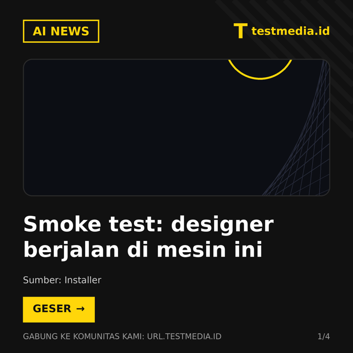

# homeless-media-automation

Auto installer for the **Homeless Media** automation: a daily AI-news
pipeline that scouts RSS feeds, scores stories for viral potential, writes
a complete Indonesian news package, renders a 2K carousel, and publishes
to Instagram, Threads, and a Facebook Page (plus an optional blog) — one
topic per day, full-auto, driven by a Muse cron job.

Built from the production system running PekaAI's socials since
2026-10-19, including the operating lessons paid for with real reach data
(see `payload/templates/learnings.md`).



## Repository layout

```
homeless-media-automation/
├── README.md                  this file
├── install.sh                 the installer (idempotent)
├── config/
│   └── hm.config.example.json every setting, documented inline
├── payload/
│   ├── hm/                    scout.py, filter.py, designer.py, requirements.txt, README.md
│   ├── templates/             engagement-playbook.md, learnings.md, trending.md (seeded per install)
│   └── cron/                  hm-daily.cron.md (token template rendered into SETUP-CRON.md)
└── docs/
    └── smoke-test-cover.png   reference render from a test install
```

## What gets installed

```
<content_dir>/
├── hm/
│   ├── scout.py         RSS ingest (8 AI feeds) -> news.db (SQLite)
│   ├── filter.py        viral scoring: recency 30 + relevance 35 + source 15 + hook 20
│   ├── designer.py      2K carousel renderer, 4 rotating daily themes + screenshot theme
│   ├── venv/            python venv (feedparser, Pillow)
│   ├── news.db          story database (dedupe by URL, used flags)
│   ├── out/  visuals/  work/  review/
│   └── README.md        pipeline reference
├── assets/mascot.png    brand mascot (or a generated placeholder)
├── engagement-playbook.md   content rules (seeded, yours to evolve)
├── learnings.md             performance lessons (seeded with proven ones)
├── trending.md              trend notes the crons read
├── posted.log
├── blog/  images/           blog output (only used when blog is enabled)
└── SETUP-CRON.md            the rendered cron body: hand this to Muse
```

## Prerequisites

- A Linux VPS running **Muse** (the pipeline's writer/poster is a Muse
  cron worker; the social CLIs live at `/opt/hatch/bin/`).
- The brand's **Instagram, Threads, and Facebook Page connected in Muse**
  on that machine, and their account IDs (the installer prints where to
  put them; the CLIs list connected accounts).
- python3 >= 3.9 with venv, DejaVu fonts (`fonts-dejavu`), network access
  to the RSS feeds.
- Optional: a blog that renders `blog/*.json` + `images/` in the documented
  format (see the blog JSON spec inside `payload/cron/hm-daily.cron.md`).

## Install

```bash
git clone <this repo> homeless-media-automation
cd homeless-media-automation
bash install.sh            # first run creates hm.config.json from the example
nano hm.config.json        # brand, handle, account IDs, content_dir, blog
bash install.sh            # installs into content_dir, renders SETUP-CRON.md
```

The installer is idempotent. Re-running refreshes code and the venv and
re-renders `SETUP-CRON.md`; it never overwrites `news.db`, logs,
`learnings.md`, `trending.md`, or the playbook.

It finishes with a **designer smoke test** (a sample carousel in
`hm/out/smoke-test/`) — open the PNGs and confirm the header lockup shows
your brand label before going live.

## Configuration (`hm.config.json`)

| Key | Meaning |
|---|---|
| `brand_name` | Display name; also the ticker text and FB page label |
| `brand_label` | Lockup text top-right of every slide (usually the domain) |
| `handle` | Social handle without @, e.g. `namamedia.id` |
| `community_url` | Footer call-to-action target, printed uppercase |
| `footer_text` | Footer label before the community URL |
| `content_dir` | Absolute path of the installed workspace |
| `timezone`, `schedule_time` | Cron schedule for the daily edition |
| `accounts.instagram_id` / `threads_id` / `facebook_page_id` | Connected account IDs |
| `blog.enabled`, `blog.base_url` | Optional blog publishing |
| `mascot_path` | Optional path (inside this repo or absolute) to the real mascot PNG; black background (it is chroma-keyed). Empty = placeholder generated |

Feeds, scoring keywords, and the accent color are code constants (documented
in the payload): `FEEDS` in `scout.py`, keyword lists in `filter.py`,
`YEL`/`BLK` in `designer.py`.

## Go live

1. Run the installer until the smoke test passes.
2. Fill the real account IDs in `hm.config.json`, re-run the installer.
3. Replace `assets/mascot.png` with the real mascot if you skipped it.
4. In Muse on that VPS, say: **"create the daily cron from
   `<content_dir>/SETUP-CRON.md`"** (schedule + title are printed at the
   end of the installer output).
5. First edition: approve the Threads/FB publish cards when they pop,
   then verify the reported links (the cron resolves canonical Threads
   URLs itself).

## Operating notes (learned in production)

- Threads/FB publishes may require a per-publish approval tap on this
  platform. Full-auto still means: everything else runs itself.
- Never delete + repost similar content; never judge performance from
  first-hour metrics; captions live in `hm/work/<date>/`, never `/tmp`.
  These and the other data-backed rules ship inside the seeded
  `engagement-playbook.md` and are binding on the cron.
- Recommended companions (not installed): a weekly engagement review that
  appends to `learnings.md`, a twice-weekly trend watch that rewrites
  `trending.md`, and a daily report comparing planned vs published slots.
  The playbook's improvement loop describes how they feed each other.

## Updating an existing install

Pull the new version of this repo and re-run the installer with the same
config. Code files, the venv, and `SETUP-CRON.md` are refreshed; runtime
state (`news.db`, `posted.log`, `learnings.md`, `trending.md`,
`engagement-playbook.md`, `assets/mascot.png`, `out/`, `work/`) is never
overwritten. If `SETUP-CRON.md` changed materially, ask Muse to update
the cron body from the new file.

## Uninstalling

1. Delete or disable the daily cron in Muse.
2. Delete the `<content_dir>` workspace. Nothing is installed outside it
   except the cron definition itself (no system packages, no services).

## Troubleshooting

- **Installer says the DejaVu fonts are missing** — `sudo apt install -y
  fonts-dejavu`, then re-run. The designer hard-requires them.
- **`feedparser` / `Pillow` import fails after install** — the venv lives
  at `<content_dir>/hm/venv`; delete it and re-run the installer to
  rebuild. Check network access to PyPI.
- **Scout self-test shows a feed as failed** — feeds go down or block
  bots occasionally; the scout skips failures and the daily run retries.
  Replace a permanently dead feed in the `FEEDS` list of the installed
  `hm/scout.py` (and in this repo's payload if it should stay fixed).
- **Smoke test carousel fails or the header looks wrong** — the mascot
  path is patched into `hm/designer.py` at install time; confirm
  `<content_dir>/assets/mascot.png` exists and is a PNG with a black
  background. A missing mascot is the usual cause.
- **Cron runs but a publish hangs** — Threads/FB publishes can wait on a
  user approval tap in Muse. That is the platform's rule, not a stuck
  job; approve it and the run continues. Never start a second run to
  "unstick" it: verify the platform post lists first (double-post risk).
- **A post went out but its link 404s in the report** — the cron resolves
  canonical Threads URLs itself; if one still fails, the post was likely
  removed on-platform. Check the account in the Threads app.
- **Two editions on the same day** — the cron's catch-up is `latest`;
  after long downtime, confirm `posted.log` before letting a manual
  re-run publish a second edition.

